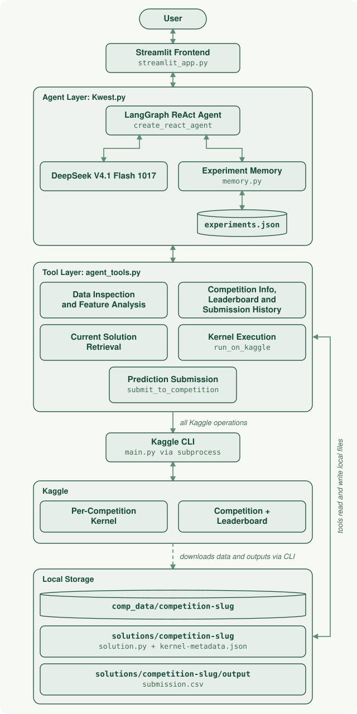

<p align="center">
  
</p>

<h1 align="center">Kwest</h1>

<p align="center">
  An AI-powered agent for automating Kaggle competition workflows.
</p>

<p align="center">
  
  
  
  
  
  
</p>

---

## Overview

Kwest is a tool-using AI agent that automates key stages of the Kaggle competition workflow, from inspecting datasets and generating machine learning code to executing training on Kaggle kernels, submitting predictions, and tracking experiments.

Built with Python, LangChain, LangGraph, and DeepSeek V4.1 Flash 1017, Kwest provides a conversational interface for managing competition experiments without repeatedly handling the same setup and execution steps manually.

<!-- Add a screenshot or GIF of the UI here, for example:
<p align="center"></p>
-->

## Why Kwest?

Iterating on Kaggle competitions involves repeatedly inspecting datasets, writing training scripts, launching kernels, checking execution results, and submitting predictions.

Kwest brings these operations into a single agent-driven workflow.

- **Automated execution:** Generates training code and runs it on Kaggle kernels.
- **Tool-based interaction:** Uses dedicated tools for dataset inspection, feature analysis, competition information, execution, and submission.
- **Experiment tracking:** Maintains persistent records of experiment descriptions, scores, and observations.
- **Competition isolation:** Maintains separate Kaggle kernels and solution files for each competition.
- **Conversational interface:** Allows users to manage competition workflows through natural-language instructions.
- **Human oversight:** Keeps the user involved in reviewing generated code, evaluating results, and deciding what to experiment with next.

## Architecture

Kwest follows a tool-calling agent architecture. The LLM interprets user requests, selects the appropriate tools, and uses their results to formulate responses. All Kaggle operations go through the Kaggle CLI, and kernel outputs are downloaded locally before submission.

<p align="center">
  
</p>

### Core Components

#### 1. Agent and Reasoning Layer

- Built using LangChain and LangGraph's `create_react_agent`.
- Uses DeepSeek V4.1 Flash 1017 as the LLM.
- Interprets natural-language requests and selects tools based on their descriptions and system instructions.
- Uses controlled tool execution to avoid unnecessary parallel calls and repeated kernel submissions.
- Maintains a limited conversation history to provide context across interactions.

#### 2. Tool Layer

Implemented in `agent_tools.py`, these tools provide access to Kaggle competition operations and local experiment data.

| Tool | Responsibility |
|---|---|
| `inspect_competition_data` | Downloads and profiles competition datasets, including shapes, data types, and missing values. |
| `analyze_feature_importance` | Performs LightGBM-based feature analysis using gain importance, correlation, mutual information, and categorical target rates. It also screens candidate features and recommends the ones that beat a noise-based gate. |
| `get_competition_info_tool` | Retrieves competition metadata and related information. |
| `get_leaderboard_tool` | Fetches competition leaderboard information. |
| `get_submissions_tool` | Retrieves submission history and scores. |
| `get_current_solution` | Reads the existing solution before modifying it. |
| `run_on_kaggle` | Writes the training script, pushes a Kaggle kernel, monitors execution, and retrieves output logs. Runs on CPU by default, with an opt-in GPU mode. |
| `submit_to_competition` | Submits the generated prediction file to the competition. |

#### 3. Kaggle Execution Layer

- Uses the Kaggle CLI through Python's `subprocess` module.
- Generates and pushes Python training scripts as Kaggle kernels.
- Monitors kernel execution and retrieves relevant logs.
- Returns the tail of the log when a kernel fails, so the agent can read the actual traceback.
- Maintains a separate kernel for each competition, with dynamically generated kernel identifiers.
- Stores competition-specific solution files and kernel metadata locally.
- Downloads the generated `submission.csv` locally before submission.

#### 4. Experiment Memory

Implemented through `memory.py` and `experiments.json`.

- Stores experiment descriptions, scores, and notes.
- Maintains experiment history across sessions.
- Provides relevant experiment context to the agent.
- Allows users to log results directly through chat.

Example command:

```text
log: LightGBM with interaction features | 0.94706 | Improved public leaderboard score
```

#### 5. Streamlit Frontend

The Streamlit interface provides a centralized workspace for interacting with Kwest.

- **Chat:** Conversational interface for requesting competition operations.
- **Kwest's Code:** Displays generated solution code and kernel information.
- **Experiments:** Displays logged experiments, scores, and observations.
- **Settings:** Manages the selected competition.
- **About:** Provides project and workflow information.

The interface uses a custom green visual theme aligned with Kwest's branding.

## Typical Workflow

1. **Configure a competition:** Enter a Kaggle competition slug in Settings.
2. **Inspect the data:** Ask Kwest to download and analyze the competition dataset.
3. **Analyze features:** Use feature importance analysis to identify potentially useful predictors.
4. **Generate and execute code:** Ask Kwest to develop a model. The agent generates a training script, pushes it to a Kaggle kernel, and monitors execution.
5. **Review results:** Inspect the generated solution, kernel status, and execution logs.
6. **Submit predictions:** Ask Kwest to submit the generated `submission.csv`.
7. **Track experiments:** Log important runs and compare results over time.

## Installation

### Requirements

- Python 3.11 (developed and tested on 3.11.9)
- A Kaggle account with an API token
- An API key for the LLM provider (Kwest uses DeepSeek V4.1 Flash through Rapid Router)

### Setup

1. Clone the repo and create a virtual environment:

```bash
git clone https://github.com/RugvedBane/Kwest.git
cd Kwest
python -m venv venv
venv\Scripts\activate        # Windows
# source venv/bin/activate   # macOS / Linux
pip install -r requirements.txt
```

2. Add your Kaggle credentials. Create an API token in your Kaggle account settings and save the downloaded `kaggle.json` to:

- Windows: `C:\Users\<you>\.kaggle\kaggle.json`
- macOS / Linux: `~/.kaggle/kaggle.json`

Kwest reads your Kaggle username from this file, or from the `KAGGLE_USERNAME` environment variable if you set it. Nothing else needs to be configured.

3. Create a `.env` file in the project root:

```text
RAPIDROUTER_API_KEY=your_rapid_router_key
```

4. Accept the rules of each competition you want to use on kaggle.com. The CLI cannot download data or submit until you do.

### Run

Streamlit UI:

```bash
streamlit run streamlit_app.py
```

Terminal chat:

```bash
python Kwest.py
```

### Notes

- Kaggle only allows kernels with internet access on phone-verified accounts, so verify your account first.
- Kwest runs on CPU by default. See [GPU and CPU Execution](#gpu-and-cpu-execution) below.
- `.env`, `kaggle.json`, and `.streamlit/secrets.toml` hold secrets and must never be committed.

## GPU and CPU Execution

Kwest runs Kaggle kernels on **CPU by default**. GPU is opt-in: it is only used when you explicitly ask for it (for example, "train this on GPU").

Kaggle's free GPU kernels (T4) are not always available. A GPU run can sit in the "Queued" state and never start. When this happens, Kwest reports the stall after about 150 seconds and stops. It does not retry on its own. You can cancel the session on kaggle.com and ask Kwest to rerun on CPU.

Use CPU for tabular models such as LightGBM, XGBoost, and CatBoost. These train quickly on CPU for typical competition datasets. Use GPU only when training neural networks, where it makes a real difference.

## Tech Stack

| Category | Technologies |
|---|---|
| Language | Python |
| Agent Framework | LangChain, LangGraph |
| LLM | DeepSeek V4.1 Flash 1017 |
| Tool Execution | LangChain Tools, Python subprocess |
| Kaggle Integration | Kaggle CLI |
| Local Analysis | LightGBM, scikit-learn, Pandas, NumPy |
| Generated Solutions (run on Kaggle) | LightGBM, XGBoost, CatBoost |
| Frontend | Streamlit |
| Experiment Storage | JSON |
| Configuration | python-dotenv |

## Project Structure

```text
Kwest/
│
├── .streamlit/                 # Streamlit configuration and secrets (secrets git-ignored)
│
├── assets/
│   └── Kwest-logo.svg          # Project logo
│
├── comp_data/                  # Downloaded competition data (git-ignored)
│
├── solutions/
│   └── <competition-slug>/
│       ├── solution.py         # Competition training script
│       ├── kernel-metadata.json  # Generated on each run (git-ignored)
│       └── output/             # Generated kernel outputs (git-ignored)
│
├── .gitignore
├── Kwest.py                    # Agent construction and system instructions
├── README.md
├── agent_tools.py              # Kaggle and ML tools
├── experiments.json            # Persistent experiment history
├── main.py                     # Kaggle CLI operations
├── memory.py                   # Experiment memory management
├── requirements.txt
└── streamlit_app.py            # Streamlit frontend
```

## Engineering Decisions

A few implementation decisions were made to improve reliability and keep the architecture manageable.

- **Dedicated competition kernels:** Each competition gets its own kernel instead of sharing one across unrelated competitions.
- **On-demand competition context:** Competition metadata, leaderboard information, and submission history are retrieved through tools rather than loading everything into the agent's initial context.
- **Controlled tool execution:** Parallel tool calls are disabled to reduce conflicting or duplicated execution requests.
- **Bounded history:** Conversation history is limited, and failed kernel runs return only the tail of the log so the agent can read the traceback without growing the context.
- **Error handling:** The agent is instructed to report execution failures and timeouts rather than automatically retrying kernel runs.
- **CPU by default:** GPU kernels are opt-in because Kaggle's GPU queue is unreliable, and the agent reports which accelerator actually ran.
- **Existing solution awareness:** The agent can retrieve the current solution before making modifications.
- **Persistent experiment tracking:** Experiment history is stored locally and remains available across sessions.

## Status

Kwest is in active development. The full competition workflow works end to end and has been validated on a real competition, but it has had limited real-world use so far. Generated code and kernel results should always be reviewed before submitting.

### End-to-End Validation

Kwest completed the following workflow on the Kaggle Playground Series S6E11 competition:

`Dataset Inspection → Feature Analysis → Model Training → Prediction Generation → Kaggle Submission`

| Approach | Public Score |
|---|---:|
| Previous manual approach | 0.94579 |
| Kwest-assisted approach | 0.94746 |

This run validates the pipeline end to end and improved on the manual baseline by a small margin. It is a single-competition result, not a claim of consistent leaderboard performance across competitions.

## Limitations

Kwest is an early version. These are the main things to know before relying on it:

- **Human-guided by design.** Kwest runs, monitors and iterates on solutions under your direction. It does not find new modeling ideas on its own, so results depend heavily on the guidance you give it.
- **Limited real-world validation.** The full workflow has been tested end to end on a small number of competitions. Results across many competitions have not been established yet.
- **Tabular competitions only.** The tools, including the feature importance analysis, assume a `train.csv` and `test.csv` setup. Image, text and other competition types are untested.
- **Short conversation memory.** Chat history is truncated to the most recent messages. Experiments are saved to `experiments.json`, but Kwest has no long-term memory of past conversations.
- **No outside knowledge of the competition.** Kwest does not read public notebooks or discussions. Its ideas come from the LLM and from you.
- **No automatic retries.** On a failed or timed-out run, Kwest reports the error and stops, and it runs one tool call per request. It does not loop on its own. For GPU stalls, see [GPU and CPU Execution](#gpu-and-cpu-execution).
- **Local use only.** Kwest is not deployed anywhere. Hosting it on Streamlit Community Cloud would wipe saved experiments and solutions, because its filesystem is temporary. A real database is needed first.
- **Pinned Kaggle CLI.** Kwest uses `kaggle==1.6.17`. Newer versions of the CLI have not been tested.
- **Review before submitting.** Generated code can contain bugs. Kwest never submits on its own, so check results before you submit.

## License

This project is licensed under the [MIT License](LICENSE).