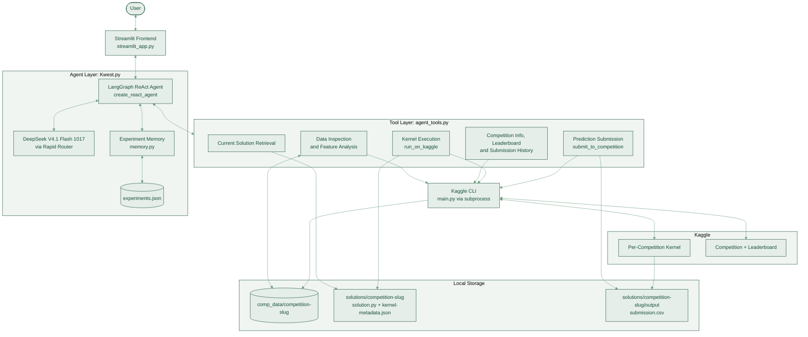

<p align="center">
  
</p>

<h1 align="center">Kwest</h1>

<p align="center">
  An AI-powered agent for automating Kaggle competition workflows.
</p>

<p align="center">
  
  
  
  
  
  
</p>

---

## Overview

Kwest is a tool-using AI agent that automates key stages of the Kaggle competition workflow, from inspecting datasets and generating machine learning code to executing training on Kaggle kernels, submitting predictions, and tracking experiments.

Built with Python, LangChain, LangGraph, and DeepSeek V4.1 Flash 1017, Kwest provides a conversational interface for managing competition experiments without repeatedly handling the same setup and execution steps manually.

<!-- Add a screenshot or GIF of the UI here, for example:
<p align="center"></p>
-->

## Why Kwest?

Iterating on Kaggle competitions involves repeatedly inspecting datasets, writing training scripts, launching kernels, checking execution results, and submitting predictions.

Kwest brings these operations into a single agent-driven workflow.

- **Automated execution:** Generates training code and runs it on Kaggle kernels.
- **Tool-based interaction:** Uses dedicated tools for dataset inspection, feature analysis, competition information, execution, and submission.
- **Experiment tracking:** Maintains persistent records of experiment descriptions, scores, and observations.
- **Competition isolation:** Maintains separate Kaggle kernels and solution files for each competition.
- **Conversational interface:** Allows users to manage competition workflows through natural-language instructions.
- **Human oversight:** Keeps the user involved in reviewing generated code, evaluating results, and deciding what to experiment with next.

## Architecture

Kwest follows a tool-calling agent architecture. The LLM interprets user requests, selects the appropriate tools, and uses their results to formulate responses. All Kaggle operations go through the Kaggle CLI, and kernel outputs are downloaded locally before submission.



### Core Components

#### 1. Agent and Reasoning Layer

- Built using LangChain and LangGraph's `create_react_agent`.
- Uses DeepSeek V4.1 Flash 1017 through Rapid Router (an OpenAI-compatible LLM router) as the LLM.
- Interprets natural-language requests and selects tools based on their descriptions and system instructions.
- Uses controlled tool execution to avoid unnecessary parallel calls and repeated kernel submissions.
- Maintains a limited conversation history to provide context across interactions.

#### 2. Tool Layer

Implemented in `agent_tools.py`, these tools provide access to Kaggle competition operations and local experiment data.

| Tool | Responsibility |
|---|---|
| `inspect_competition_data` | Downloads and profiles competition datasets, including shapes, data types, and missing values. |
| `analyze_feature_importance` | Performs LightGBM-based feature analysis using gain importance, correlation, mutual information, and categorical target rates. |
| `get_competition_info_tool` | Retrieves competition metadata and related information. |
| `get_leaderboard_tool` | Fetches competition leaderboard information. |
| `get_submissions_tool` | Retrieves submission history and scores. |
| `get_current_solution` | Reads the existing solution before modifying it. |
| `run_on_kaggle` | Writes the training script, pushes a Kaggle kernel, monitors execution, and retrieves output logs. |
| `submit_to_competition` | Submits the generated prediction file to the competition. |

#### 3. Kaggle Execution Layer

- Uses the Kaggle CLI through Python's `subprocess` module.
- Generates and pushes Python training scripts as Kaggle kernels.
- Monitors kernel execution and retrieves relevant logs.
- Maintains a separate kernel for each competition, with dynamically generated kernel identifiers.
- Stores competition-specific solution files and kernel metadata locally.
- Downloads the generated `submission.csv` locally before submission.

#### 4. Experiment Memory

Implemented through `memory.py` and `experiments.json`.

- Stores experiment descriptions, scores, and notes.
- Maintains experiment history across sessions.
- Provides relevant experiment context to the agent.
- Allows users to log results directly through chat.

Example command:

```text
log: LightGBM with interaction features | 0.94706 | Improved public leaderboard score
```

#### 5. Streamlit Frontend

The Streamlit interface provides a centralized workspace for interacting with Kwest.

- **Chat:** Conversational interface for requesting competition operations.
- **Kwest's Code:** Displays generated solution code and kernel information.
- **Experiments:** Displays logged experiments, scores, and observations.
- **Settings:** Manages the selected competition.
- **About:** Provides project and workflow information.

The interface uses a custom green visual theme aligned with Kwest's branding.

## Typical Workflow

1. **Configure a competition:** Enter a Kaggle competition slug in Settings.
2. **Inspect the data:** Ask Kwest to download and analyze the competition dataset.
3. **Analyze features:** Use feature importance analysis to identify potentially useful predictors.
4. **Generate and execute code:** Ask Kwest to develop a model. The agent generates a training script, pushes it to a Kaggle kernel, and monitors execution.
5. **Review results:** Inspect the generated solution, kernel status, and execution logs.
6. **Submit predictions:** Ask Kwest to submit the generated `submission.csv`.
7. **Track experiments:** Log important runs and compare results over time.

## Tech Stack

| Category | Technologies |
|---|---|
| Language | Python |
| Agent Framework | LangChain, LangGraph |
| LLM | DeepSeek V4.1 Flash 1017 |
| LLM Provider | Rapid Router |
| Tool Execution | LangChain Tools, Python subprocess |
| Kaggle Integration | Kaggle CLI |
| Local Analysis | LightGBM, scikit-learn, Pandas, NumPy |
| Generated Solutions (run on Kaggle) | LightGBM, XGBoost, CatBoost |
| Frontend | Streamlit |
| Experiment Storage | JSON |
| Configuration | python-dotenv |

## Project Structure

```text
Kwest/
│
├── .streamlit/                 # Streamlit configuration and secrets (secrets git-ignored)
│
├── assets/
│   └── kwest-logo.svg          # Project logo
│
├── comp_data/                  # Downloaded competition data (git-ignored)
│
├── solutions/
│   └── <competition-slug>/
│       ├── solution.py         # Competition training script
│       ├── kernel-metadata.json
│       └── output/             # Generated kernel outputs (git-ignored)
│
├── .gitignore
├── Kwest.py                    # Agent construction and system instructions
├── README.md
├── agent_tools.py              # Kaggle and ML tools
├── experiments.json            # Persistent experiment history
├── main.py                     # Kaggle CLI operations
├── memory.py                   # Experiment memory management
├── requirements.txt
└── streamlit_app.py            # Streamlit frontend
```

## Engineering Decisions

A few implementation decisions were made to improve reliability and keep the architecture manageable.

- **Dedicated competition kernels:** Each competition gets its own kernel instead of sharing one across unrelated competitions.
- **On-demand competition context:** Competition metadata, leaderboard information, and submission history are retrieved through tools rather than loading everything into the agent's initial context.
- **Controlled tool execution:** Parallel tool calls are disabled to reduce conflicting or duplicated execution requests.
- **Bounded execution history:** Conversation history and returned kernel logs are limited to prevent unnecessary context growth.
- **Error handling:** The agent is instructed to report execution failures and timeouts rather than automatically retrying kernel runs.
- **Existing solution awareness:** The agent can retrieve the current solution before making modifications.
- **Persistent experiment tracking:** Experiment history is stored locally and remains available across sessions.

## Current Status

**Functional prototype under active development.** Kwest works end to end, but it is not yet fully reliable. Generated code and kernel results should always be reviewed by the user.

Implemented and tested:

- LangChain and LangGraph agent with tool calling.
- Eight competition-related tools.
- Competition dataset inspection and feature importance analysis.
- Per-competition Kaggle kernel creation and execution.
- Kernel status monitoring and output retrieval.
- Automated prediction submission.
- Persistent experiment logging and retrieval.
- Streamlit-based conversational frontend.

### End-to-End Validation

Kwest completed the following workflow on the Kaggle Playground Series S6E11 competition:

`Dataset Inspection → Feature Analysis → Model Training → Prediction Generation → Kaggle Submission`

| Approach | Public Score |
|---|---:|
| Previous manual approach | 0.94579 |
| Kwest-assisted approach | 0.94706 |

This run validates the pipeline end to end and improved on the manual baseline by a small margin. It is a single-competition result, not a claim of consistent leaderboard performance across competitions.

## Future Improvements

The current priority is improving the reliability of existing functionality rather than continuously expanding the toolset.

- More reliable code generation and modification.
- Better validation of tool outputs and execution results.
- Improved conversation and experiment context management.
- More robust kernel monitoring and failure handling.
- Error analysis using out-of-fold predictions.
- Deployment through Streamlit Community Cloud.
- Automated code-quality checks through GitHub Actions.
